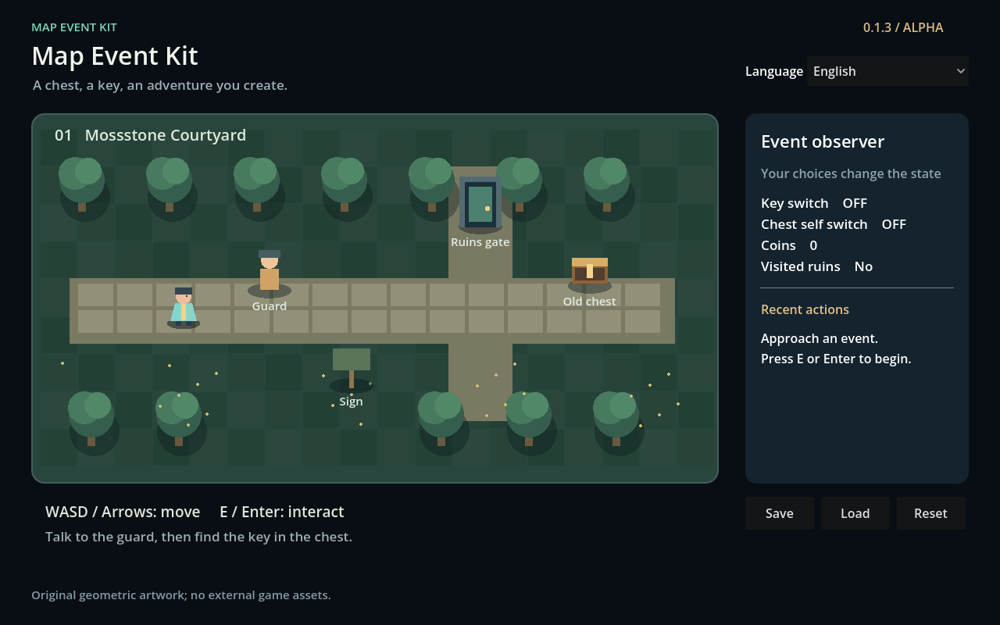
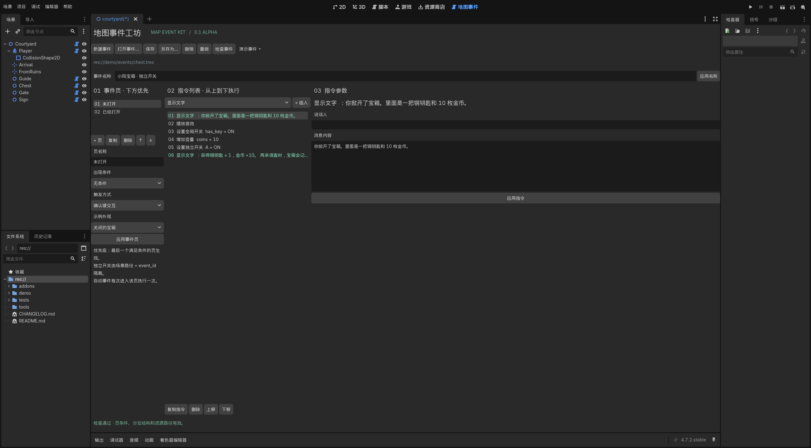

# Map Event Kit

RPG Maker style map events for Godot: event pages, conditions, command lists and a playable two-map demo.

**0.1.3-alpha** · **MIT** · Tested with **Godot 4.7.2 Standard / Windows / Compatibility**.

[GitHub repository](https://github.com/NoHaxJsut-Luck/godot-map-event-kit)

## Documentation

- [User manual — English → 日本語 → 한국어 → 中文](docs/USER_MANUAL.md)
- [Technical documentation — English](docs/TECHNICAL.md)

Open the **Map Events** tab and choose **English / 日本語 / 한국어 / 简体中文** at the top right. The default follows Godot’s editor language, with English as the fallback. Switching updates the editor immediately and preserves pending input and undo history. Your preference is saved locally for this project. The demo also has its own four-language selector during play, including all built-in dialogue and choices. User-authored text without a catalog entry stays unchanged.

## Try the demo

Download the repository with **Code → Download ZIP**, extract it and import `project.godot` in Godot. Press **F5**. Move with WASD or the arrow keys; interact with E, Enter or Space. Open the chest, unlock the gate, visit the ruins and try saving and loading.

Windows users can also run `Launch Demo.cmd` or `Open Editor.cmd` when Godot is discoverable. The engine is not included.

In the running demo, use the language selector at the top right. Language changes also update an open dialogue without advancing the event. The preference survives map transfers and restarts, and loading a game does not override it. The demo starts in English on first launch. Its selector is always labelled **Language**, with each language shown in its native script. Previously saved choices are preserved; System / Auto is optional.

[Demo language checks — 48 passing](docs/testing/demo-language-tests.json) · [English dialogue screenshot](docs/images/demo-choices-en.png) · [日本語](docs/images/demo-choices-ja.png) · [한국어](docs/images/demo-choices-ko.png)

## Install the addon

Copy `addons/map_event_kit` into your project's `addons` folder and enable **Map Event Kit / 地图事件工坊** in Project Settings → Plugins. Follow the [installation steps](docs/USER_MANUAL.md#install-in-your-project) to connect your player, assign an event resource and test an interaction.

## What is included

- Event pages with global switches, self switches and variable conditions.
- Sixteen commands for dialogue, choices, state changes, nested branches, waits, sound, map transfers and custom hooks.
- Interaction, proximity and autorun triggers.
- Visual forms with validation, undo/redo and resource saving.
- Event-state persistence, example scenes and automated checks.

The local verification reports contain [30 runtime checks](docs/testing/runtime-tests.json) and [50 editor checks](docs/testing/editor-tests.json), all passing. Installation in a fresh blank project also passed. Arbitrary existing projects, other platforms and exported builds have not been verified.

This Alpha does not include battles, an inventory database, parallel events, movement routes or RPG Maker project import. Existing input, dialogue and save systems need project-specific integration.

## Development and distribution

See the [technical documentation](docs/TECHNICAL.md#verification-and-reproducible-commands) for test commands. Run `python tools/package.py` to produce addon and demo ZIPs in `dist/`; both include the manuals. The project is available on [itch.io](https://nohaxjsut-luck.itch.io/godot-map-event-kit); check the download filename for its release version.

Source code and bundled demo assets use the [MIT license](LICENSE). The demo uses generated shapes and synthesized audio.
