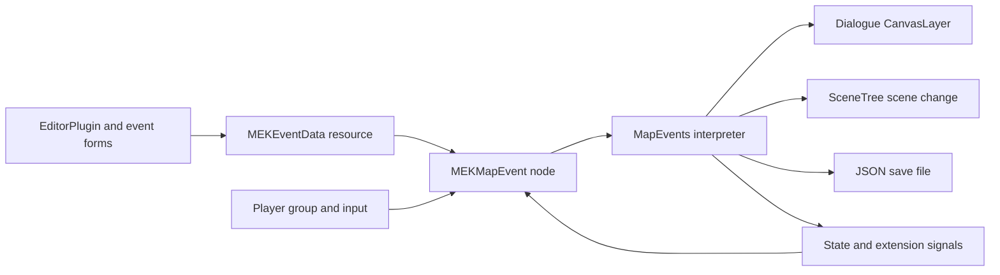

# Map Event Kit Technical Documentation

Version **0.1.1-alpha** · 2026-10-18

Repository: [NoHaxJsut-Luck/godot-map-event-kit](https://github.com/NoHaxJsut-Luck/godot-map-event-kit)

[User manual in English, Japanese, Korean and Chinese](USER_MANUAL.md) · [MIT license](../LICENSE)

## Scope and tested environment

Map Event Kit implements a Godot editor for event pages and a small sequential interpreter for map interactions. A scene node supplies identity and triggering; a resource supplies conditions and commands; an autoload holds state across scene changes. It is intended for conversations, chests, gates and scene transitions.

The tested configuration is **Godot 4.7.2 Standard on Windows with the Compatibility renderer**. Runtime checks, editor checks and a fresh addon installation have passed. These results do not establish compatibility with arbitrary existing projects, other engine versions or exported builds. The editor interface and manual support English, Japanese, Korean and Simplified Chinese. Authored demo story text remains Chinese.

## Source layout

| Source | Responsibility |
|---|---|
| [plugin.gd](../addons/map_event_kit/plugin.gd) | Editor lifecycle, main screen, autoload registration, build gate and test hook |
| [event_editor.gd](../addons/map_event_kit/editor/event_editor.gd) | Page and command forms, resource editing, undo/redo, validation and persistence |
| [event_data.gd](../addons/map_event_kit/core/event_data.gd) | `MEKEventData`, defaults and validation |
| [map_event.gd](../addons/map_event_kit/runtime/map_event.gd) | `MEKMapEvent`, identity, page refresh, triggers and placeholder drawing |
| [event_runtime.gd](../addons/map_event_kit/runtime/event_runtime.gd) | `MapEvents`, state, interpreter, cancellation, transfer and save/load |
| [dialogue.gd](../addons/map_event_kit/runtime/dialogue.gd) | Built-in dialogue and choice UI |
| [player.gd](https://github.com/NoHaxJsut-Luck/godot-map-event-kit/blob/main/demo/player.gd) and [world.gd](https://github.com/NoHaxJsut-Luck/godot-map-event-kit/blob/main/demo/world.gd) | Example controller, map drawing and state inspector |
| [run.gd](https://github.com/NoHaxJsut-Luck/godot-map-event-kit/blob/main/tests/run.gd) and [editor_smoke.gd](https://github.com/NoHaxJsut-Luck/godot-map-event-kit/blob/main/tests/editor_smoke.gd) | Runtime integration checks and editor checks |
| [package.py](https://github.com/NoHaxJsut-Luck/godot-map-event-kit/blob/main/tools/package.py) | Addon and demo ZIP generation and SHA-256 manifest |



The addon depends on Godot's built-in APIs, with no third-party runtime packages. The demo's shapes and synthesized audio are included in the repository; no extracted commercial game assets are bundled.

## Editor lifecycle and autoload ownership

`plugin.gd` creates a `VBoxContainer` main screen and adds it through `EditorInterface`. `_handles()` accepts `MEKEventData` and `MEKMapEvent`; selecting an event node opens its assigned resource. There is no separately registered custom node type: Godot discovers the scripts' `class_name` declarations.

Enabling the plugin registers `MapEvents` at `res://addons/map_event_kit/runtime/event_runtime.gd`. On first import, registration waits for a short timer and the editor filesystem scan to finish, avoiding premature UID lookup. Godot can store an autoload as either a resource path or a `uid://` reference. `_owns_autoload()` resolves both forms and checks the resulting script path.

If another script already owns `MapEvents`, the plugin emits a warning and does not overwrite it. `_build()` rejects running from the editor until this name resolves to the expected runtime. Disabling the plugin removes only its own autoload. Removing the editor panel calls `save_all()` for tracked edits; unsaved new resources still require an explicit Save As. The user should apply forms and save before closing.

The addon currently relies on the `MapEvents` name in multiple places. Changing only the autoload setting is not a supported rename operation.

## Resource model

`MEKEventData` is an `@tool Resource` with an exported `title: String` and `pages: Array[Dictionary]`. Godot serializes it as a `.tres` file. Each page is a dictionary:

```gdscript
{
    "name": "Closed chest",
    "condition": "always",
    "key": "",
    "value": true,
    "trigger": "interact",
    "visual": "chest",
    "commands": [
        {"op": "add_variable", "key": "coins", "value": 10},
        {"op": "set_self_switch", "key": "A", "value": true},
        {"op": "text", "speaker": "", "text": "Found 10 coins!"}
    ]
}
```

| Field | Values and semantics |
|---|---|
| `name` | Editor-facing page name |
| `condition` | `always`, `switch`, `self_switch`, `variable` |
| `key` | State key; unused for `always` |
| `value` | Boolean for switch conditions; integer threshold for variable conditions |
| `trigger` | `interact`, `touch`, `autorun` |
| `visual` | `marker`, `npc`, `chest`, `chest_open`, `door`, `portal` |
| `commands` | Ordered array of command dictionaries |

`active_page()` scans backward and returns the first matching index, or `-1`. Therefore the last matching page takes priority. A variable page condition always uses `>=`; command-level variable conditions support six comparisons. Missing switches default to `false`; missing variables default to `0`.

`MEKEventData.validate()` checks page conditions, triggers, command names, required state keys, finite numeric values, branch balance, option counts, waits and scene/audio resource types. Choices require 2–6 nonempty strings; waits accept 0–60 seconds. Numeric command values must be finite and within ±1,000,000,000. Variable commands convert to integers, and the runtime clamps assigned variables to that range.

Validation runs from the editor and before event execution. It validates the whole resource, including inactive pages. It is not a complete schema validator for arbitrary hand-edited dictionaries; the form editor is the intended authoring path. Event resources do not yet carry a migration version.

## Form editing and undo history

The editor uses three columns: page list and page settings, command list, and command parameters. The command picker maps a stable operation identifier to a localized display label. Forms are constructed according to the selected operation.

Typing changes a form control only. Apply collects its values, deep-copies the page array and commits the new data through `EditorUndoRedoManager`. Each action stores both the previous and next property values and calls `_changed()` on redo and undo. The resource is the custom history context, so edits belong to its history.

`_changed()` emits the resource's change signal, records it in `dirty_resources`, refreshes the visible resource and validates it. Tracking resources by instance ID allows previously edited resources to remain eligible for saving after the user switches selection. Save uses `ResourceSaver`; Save As establishes the external `.tres` path. Branch indentation is calculated for display; the underlying command array remains flat.

## Event identity and triggers

`MEKMapEvent` extends `Node2D`. Its exported properties are `event_id`, `display_name`, `data`, `marker_color` and `interaction_radius`. It joins `map_event_objects` at runtime and looks up `/root/MapEvents`.

`identity()` walks from the event toward the tree root and keeps the outermost nonempty `scene_file_path`. The event key is:

```text
<outermost scene path>::<event_id>
```

A self-switch key appends `::<switch name>`. Two nodes can share one resource and retain separate self-switch state if their identities differ. Duplicated IDs within that scene identity disable both conflicting nodes and emit `event_error`. Fixing IDs requires restarting or recreating those instances. Keep IDs stable, unique and free of the `::` separator; changing a scene path or ID requires explicit save migration if old progress must survive.

The node observes `state_changed` and recomputes its active page. Page changes reset its autorun and proximity-entry bookkeeping. Placeholder rendering reflects the selected page; editor previews use the first page. This drawing is demonstration art, not a sprite or animation system. A derived event script can override `_draw()` to use custom visuals, and child sprites can supply the actual art.

| Trigger | Implementation |
|---|---|
| Interaction | `_unhandled_input()` accepts physical E or `ui_accept`, checks player distance against the node's radius, and yields to a closer valid interaction event. It consumes the accepted input. |
| Proximity | `_process()` detects entry into a distance strictly below 30 pixels. This does not use physics collision shapes. |
| Autorun | `_process()` starts the active page once while idle; page changes or a new scene instance allow it to run again. |

All triggers use the first `Node2D` in `map_event_player`. The design assumes one player. Proximity entries while another event is busy are not queued; the player may need to leave and re-enter. Interaction does not check facing direction, walls or line of sight. Existing UI can consume input before `_unhandled_input()` receives it.

## Interpreter and cancellation

`run_event(event)` rejects an occupied runtime, invalid event node, invalid resource or absent matching page. It deep-copies the selected page's commands, increments a generation counter, remembers the current event and sets `busy = true`. This snapshot means a self-switch update can change the visible page without replacing the running list.

The interpreter walks the snapshot in order. Branch control uses a stack of frames containing `parent` and `passed`:

1. An `if_*` pushes the previous enabled state and its own test result. The body is enabled only when both are true.
2. `else` uses `parent && !passed`.
3. `end` restores the parent state and pops the frame.

Structural commands are processed even inside disabled branches. This prevents an inner `else` from activating code under a false outer condition. Only enabled nonstructural commands emit `trace`; branch markers and skipped commands do not appear in that signal. Its index is zero-based within the original snapshot.

Dialogue, choices and waits suspend execution. The interpreter compares its captured generation with the current generation when resuming. `cancel()` increments the generation, clears the current event, cancels the dialogue and releases the busy flag. An event's `_exit_tree()` invokes cancellation when that node owns the active run. A waiting timer itself is not destroyed; its eventual continuation exits without executing more commands. Cancellation does not roll back changes already made or stop previously started audio.

Normal completion and `stop` release the lock and return `true`. Validation rejection and cancellation return `false`. Transfer returns the scene-change request result and terminates the list. The loop also yields at certain 64-command boundaries on its regular execution path; skipped and structural commands bypass that yield. This is not a frame-time guarantee for arbitrarily large lists.

## Command schema

All entries require `op`. Authoring defaults are defined in `default_command()`.

| Operation | Parameters | Runtime behavior |
|---|---|---|
| `text` | `speaker`, `text` | Wait for dialogue confirmation |
| `choices` | `text`, `options: Array`, `key` | Wait and store the zero-based answer in an integer variable |
| `set_switch` | `key`, `value: bool` | Update global switch and emit state change |
| `set_self_switch` | `key`, `value: bool` | Update the current event's self switch |
| `set_variable` | `key`, `value` | Convert to integer and clamp |
| `add_variable` | `key`, `value` | Add to the current value, then clamp |
| `if_switch` | `key`, `value: bool` | Test global switch equality |
| `if_self_switch` | `key`, `value: bool` | Test self-switch equality |
| `if_variable` | `key`, `value`, `compare` | Compare using `==`, `!=`, `>=`, `<=`, `>` or `<` |
| `else` | None | Alternative for the current branch |
| `end` | None | Close the current branch |
| `wait` | `seconds` | Await a SceneTree timer |
| `transfer` | `scene`, `spawn` | Change scene and end the event |
| `sound` | `path`, `volume_db` | Create an AudioStreamPlayer; volume clamped to −80…6 dB; free on completion |
| `custom` | `name`, `argument` | Emit a synchronous extension signal |
| `stop` | None | End the event |

Sound playback does not block. `custom` does not await asynchronous listeners. Waiting for a cutscene or move route requires extending the interpreter with a cancellable awaited operation; attaching an async function to the current signal does not make the runner wait.

## Dialogue implementation

`dialogue.gd` creates a `CanvasLayer` on layer 90 with a bottom panel, speaker label, wrapped message label and horizontal row of buttons. `ask(command)` rebuilds the buttons, shows the panel, defers focus to the first button and awaits `answered`. A text command uses one continuation button; choices return their zero-based index. `cancel()` resolves the pending question with `-1`.

This UI has no typewriter effect, text localization, pagination or portrait system. Long messages and long option labels may require layout work for the target resolution. To integrate an existing dialogue system, preserve the runner's awaited answer and cancellation contract instead of showing a second independent dialogue window. `auto_answer` is a test hook; leave it at its default `-1` in gameplay.

## Player and scene integration

Players join `map_event_player`, stop movement while `MapEvents.busy` is true, and defer `MapEvents.place_player(self)` from `_ready()`. See the manual for a minimal controller integration. The plugin does not move or lock arbitrary controllers automatically.

Transfer stores `pending_spawn`, clears `current_event`, releases busy, requests `SceneTree.change_scene_to_file()` and ends the list. Clearing the owner avoids treating the departing scene as an unexpected cancellation. `place_player()` consumes a saved position first, otherwise resolves the spawn path relative to the new current scene. Spawn nodes must be `Node2D`; `Marker2D` is the recommended authoring node. A missing marker emits an error and clears the pending spawn. The destination must include a correctly integrated player.

## State and extension API

Use setters rather than editing dictionaries directly so that event pages refresh.

| API | Purpose |
|---|---|
| `set_switch(key: String, value: bool)` | Set a global boolean |
| `set_variable(key: String, value: int)` | Set a bounded integer |
| `set_self_switch(event_key: String, key: String, value: bool)` | Set a self switch |
| `condition(page: Dictionary, event_key: String) -> bool` | Evaluate one page condition |
| `active_page(data: Resource, event_key: String) -> int` | Select the highest-priority page |
| `run_event(event: Node) -> bool` | Await an event execution |
| `cancel()` | Cancel current execution without reverting state |
| `place_player(player: Node2D)` | Consume pending load position or transfer spawn |
| `save_game() -> Error`, `load_game() -> Error` | Persist or restore progress |
| `reset_state()` | Cancel and clear live state; retain disk saves |

Signals are `state_changed()`, `busy_changed(value: bool)`, `trace(event_key: String, index: int, command: Dictionary)`, `event_error(message: String)` and `custom_command(command_name: String, argument: String, event_key: String)`.

For example, attach a listener to a persistent game service and connect a custom event command named `give_item` to your own inventory:

```gdscript
extends Node

func _ready() -> void:
    MapEvents.custom_command.connect(_on_custom_command)

func _on_custom_command(command_name: String, argument: String, event_key: String) -> void:
    if command_name == "give_item":
        print("Inventory adapter: ", argument, " from ", event_key)
        # Call your inventory service here.
```

The example only logs the request. The addon has no inventory service. Treat custom command names and arguments as your project's interface and validate them in its adapter.

To add an operation, update the editor's `OPS` and `LABELS`, parameter form, `default_command()`, validator and interpreter dispatch together. Add a runtime test for its observable behavior. An asynchronous operation must cooperate with `generation` cancellation and release any UI or controller locks it owns.

## Save format and failure behavior

The default `save_path` is `user://map_event_kit/save_01.json`. Change it for project-specific slots. `save_game()` needs a saved current scene and a registered player. Save and load return `ERR_BUSY` while an event runs.

```json
{
  "version": 1,
  "switches": {"has_key": true},
  "variables": {"coins": 10},
  "self_switches": {"res://maps/village.tscn::chest_01::A": true},
  "scene": "res://maps/ruins.tscn",
  "position": [320.0, 240.0]
}
```

`write_snapshot()` creates the directory, writes and flushes a `.tmp` file, moves the old save to `.bak` if present, then renames the temporary file into place. If the final rename fails, it attempts to restore the backup. This replacement strategy retains a previous save, but it is not a crash-proof transaction or a durability guarantee across every filesystem. Loading does not automatically fall back to `.bak`.

`validate_snapshot()` checks version 1, dictionary fields, string keys, boolean switches, finite integral variables within range, two finite bounded coordinates and an existing `res://` PackedScene. Invalid JSON or invalid snapshots return `ERR_FILE_CORRUPT` before mutating live state. Valid loads copy the state, queue the position and request a scene change. If that scene-change request subsequently fails, the copied state is not rolled back. Check the returned `Error` in the game UI.

Only plugin state, scene and global player position are saved. Inventory, arbitrary nodes, active command position and unrelated game state are not included. There is no save migration, automatic backup recovery or mid-dialogue resume. Stable scene paths and event IDs are part of save compatibility.

## Editor localization

`core/localization.gd` owns the message catalog. Chinese source messages map to English, Japanese and Korean strings; format placeholders are preserved. `resolve()` normalizes regional tags (for example `ja_JP` and `ko-KR`), maps Chinese variants to Simplified Chinese, and falls back to English for unsupported locales. Unknown message keys are returned unchanged. `python tools/check_translations.py` checks UI/validator coverage, duplicates and placeholder parity.

The panel's `language_choice` is `auto`, `en`, `ja`, `ko` or `zh_CN`. The `auto` choice reads Godot's `interface/editor/editor_language`; the panel listens for editor settings changes. `EditorSettings.set_project_metadata()` stores the choice under `map_event_kit/editor_language`. It is local editor metadata, not a shared project or game-save setting. The main-screen tab remains **Map Events** so Godot can reliably activate it across language changes. Engine-owned menus and file-dialog controls retain the engine's language.

Labels and dropdown display strings carry source-message metadata. `_apply_language()` updates those nodes in place, leaving form controls, selection, user text, option metadata, resource data and undo history intact. It refreshes command summaries and diagnostics without rebuilding the forms. The addon does not call `TranslationServer.set_locale()` or register global translations, and disables automatic translation on its panel to prevent the host game's catalog from rewriting authored content.

`MEKEventData.validate(data, locale)` produces localized page/command prefixes and error messages. The optional locale defaults to `zh_CN` to preserve runtime behavior for existing callers. `default_page(locale)` and `default_command(op, locale)` localize starter text only when a new resource or command is created. Existing dialogue, page names, command identifiers, keys and paths are never translated. The demo's story and runtime dialogue are outside this editor-language feature.

Editor regression checks exercise all four languages through the picker signal, pending text/number/boolean and choice inputs, resource immutability, validation messages, preference persistence on panel recreation, regional fallback, and undo/redo across language switches. Screenshots can be generated using the non-headless editor harness; these do not establish compatibility with other platforms.

## Verification and reproducible commands

The checked-in [runtime report](testing/runtime-tests.json) contains **30 passing checks**, and the [editor report](testing/editor-tests.json) contains **50 passing checks**, both with zero failures. They are snapshots of local verification, not a hosted CI service or a compatibility guarantee.

Runtime coverage includes all demo resource validation, E-key interaction, choices, nested branch suppression, one-time rewards, self-switch isolation, busy save rejection, cancellation during waits/dialogue, duplicate IDs, scene transfer, autorun, save replacement, position restoration, corrupt saves and resource serialization. Editor coverage includes autoload paths and UIDs, rendering the lists, Apply, undo/redo, command duplication/deletion, page creation/reordering/deletion and Save As/reload.

A separately extracted addon has also been installed in a fresh minimal project, and the extracted demo has imported and run. These installation checks are separate from the two test harnesses and do not test a pre-existing user project. Most automated dialogue sequences use the answer hook; a dedicated test verifies an actual pending dialogue and cancellation. The checks do not exhaustively cover every command, manual interaction or failure path.

From the repository root, using a console-capable Godot executable:

```powershell
$godotExe = 'C:\Path\To\Godot_v4.7.2-stable_win64_console.exe'
& $godotExe --headless --path . --editor --import --quit
& $godotExe --headless --path . --script res://tests/run.gd
$env:MEK_EDITOR_TEST = '1'
try {
    & $godotExe --headless --path . --editor --quit-after 900
} finally {
    Remove-Item Env:\MEK_EDITOR_TEST -ErrorAction SilentlyContinue
}
```

Check each process exit code and the `failed` values in the reports. The editor hook waits for initial scanning and exits when finished. Test save files use `user://map_event_kit_tests`, separate from the demo save. Current results are written into `artifacts/runtime-tests.json` and `artifacts/editor-tests.json`; those generated files are excluded from Git. For a visible editor screenshot, omit `--headless` from the editor test invocation. The demo supports `--capture-preview` for a viewport image.

## Distribution and development

Clone the public repository and import it with Godot:

```text
git clone https://github.com/NoHaxJsut-Luck/godot-map-event-kit.git
```

Run `python tools/package.py` with Python 3 to create addon-only and full-demo ZIPs in `dist/`, plus `checksums.json`. Both packages include these documents and the license. The full demo also includes scenes, tests, tooling and available verification artifacts. Generated engine caches, local scratch projects and Git metadata are excluded. Python is only needed for development tooling, not to use the addon.

`tools/build_demo.py` regenerates authored demo resources and audio and overwrites those files; do not run it as an installation step. Windows launchers locate a nearby development engine, then `GODOT_BIN`, then `godot` or `godot4` on PATH. On other platforms, import `project.godot` directly; those platforms remain unverified.

The repository and bundled demonstration assets are distributed under the existing MIT license. The project has an [itch.io page](https://nohaxjsut-luck.itch.io/godot-map-event-kit). No Godot Asset Library listing is claimed.

## Current boundaries

The Alpha has one active event, one player and one built-in dialogue surface. It does not provide battle systems, inventory databases, movement routes, parallel interpreters, RPG Maker import, save migrations or compatibility adapters for other plugins. There is no production stability commitment yet.

Integration work should first resolve the autoload name, controller locking, input ownership, dialogue ownership and save ownership. Export presets must include scenes and audio referred to by string paths; inspect the target export and test transfers and sounds in the exported build. Resource validation in the editor alone does not establish export compatibility.

Potential future work includes runtime story localization, stable IDs independent of scene paths, a versioned resource schema, awaited extension commands and adapters for existing dialogue/save systems. These are design directions, not implemented features.
